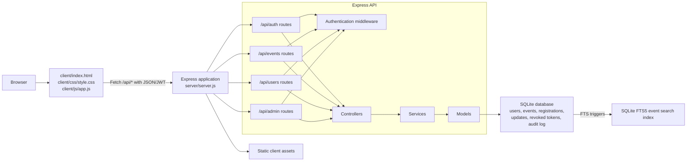

# Current Implementation Architecture

This is an as-built component view derived from the repository source. It describes the running implementation, not every design choice in the older Word architecture document.

## Source mapping

| Component | Source |
|---|---|
| Browser UI and API calls | `client/index.html`, `client/css/style.css`, `client/js/app.js` |
| HTTP server, static files, API mounting, health endpoint | `server/server.js` |
| Route definitions | `server/routes/` |
| Request/response handling | `server/controllers/` |
| Business rules | `server/services/` |
| Persistence queries and schema initialization | `server/models/`, `server/db.js` |
| Authentication, role checks, and payload validation | `server/middleware/` |
| Persistence | SQLite via `better-sqlite3`; FTS5 is used for event text search |

The application is a vanilla HTML/CSS/JavaScript client served by Express, with an Express API and SQLite persistence. Some older planning documents describe different technologies; those descriptions should not be used as evidence of the current implementation.
